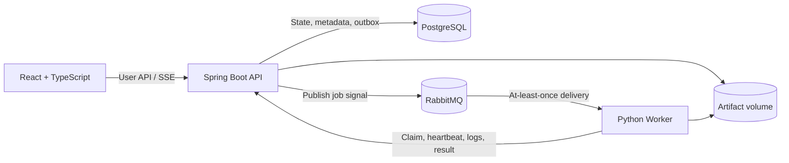

# LabFlow

> A reliable distributed job platform for reproducible scientific computing.

LabFlow is a portfolio project for laboratory teams that need to submit, run, observe, and compare scientific computing jobs. The system accepts validated molecular inputs and versioned PySCF configurations, dispatches work to Python workers, streams execution logs, and preserves enough provenance to explain and reproduce every result.

**Live:** [lab-flow.online](https://lab-flow.online) runs the production stack on a single VM. Public sign-up is closed; accounts are created by the operator. Anyone can try the read-only demo with **Explore demo** on the sign-in page.

The central engineering problem is reliability rather than raw job volume. LabFlow is designed around RabbitMQ's **at-least-once delivery**: a job may be executed more than once after a failure, but leases, attempt tokens, and a database uniqueness constraint ensure that only one valid final result is accepted.

## Why LabFlow?

Scientific jobs are long-running and failure-prone. A worker can disappear after accepting a message, a broker can redeliver an event, and a client can retry the same submission. Treating these as normal system behavior leads to several explicit design goals:

- **Idempotent submission** — concurrent requests with the same `Idempotency-Key` create one job.
- **Recoverable execution** — heartbeats and leases allow an abandoned job to be claimed by another worker.
- **Fenced results** — a stale worker cannot overwrite the result of a newer attempt.
- **Reproducibility** — each job records immutable input, configuration, code, image, and runtime metadata.
- **Observable behavior** — job events, attempts, live logs, retry reasons, and recovery time remain inspectable.

LabFlow does **not** claim strict exactly-once execution. Its intended guarantee is:

> Work may run more than once, but only one authorized final result can be committed for a job.

## Architecture



PostgreSQL is the source of truth for job state. RabbitMQ carries only execution signals. Workers do not write job state directly to the database; they use protected internal APIs so state transitions, authorization, lease checks, and result fencing remain centralized in the backend.

The intended execution flow is:

1. The API creates a job, an idempotency record, and an outbox event in one database transaction.
2. The outbox publisher sends the job ID to RabbitMQ.
3. A worker consumes the message and atomically claims a new job attempt.
4. The worker uploads ordered log chunks and runs a whitelisted task in an isolated subprocess.
5. The backend accepts the result only when the attempt token is still active.
6. A scheduled RecoveryReaper marks expired attempts `LOST` and requeues eligible jobs through a new Outbox event. Jobs that exhaust `maxAttempts` become `FAILED`.

The [reliability model](docs/RELIABILITY.md) explains each mechanism, and the [API reference](docs/API.md) lists the endpoints.

## Run the local stack

### Prerequisites

- Docker Engine or Docker Desktop with Docker Compose

The Compose file includes development defaults. Copy `.env.example` to `.env` first if you want to customize credentials or host ports.

```bash
git clone https://github.com/xyydcoldcold/LabFlow.git
cd LabFlow
docker compose up --build --wait
```

The local services are available at:

- Frontend: `http://localhost:3000`
- Backend API: `http://localhost:8080`
- Backend health: `http://localhost:8080/actuator/health`
- RabbitMQ Management: `http://localhost:15672`
- PostgreSQL: `localhost:5432`

Stop the stack without deleting persistent database or broker volumes:

```bash
docker compose down
```

See [Testing](docs/TESTING.md) for the full check commands and browser acceptance flow.

For a manual run, upload [`examples/h2.xyz`](examples/h2.xyz), create an RHF/`sto-3g` configuration with charge 0 and spin 0, then select both in Jobs, click **Review submission**, and confirm with **Submit job**. The expected converged energy is approximately **−1.1167593074 Hartree**.

## Production deployment and CD

Production is one VM running `docker-compose.prod.yml`: a Caddy gateway (the only service publishing ports, 80/443 with automatic HTTPS) in front of the frontend, backend, worker, PostgreSQL, and RabbitMQ. `scripts/deploy.py` generates server-local credentials, validates the configuration, and on `up` builds images, stops the gateway, drains queued/running jobs, backs up the database and artifacts, and then replaces the containers. Follow [the cloud deployment runbook](docs/CLOUD_DEPLOYMENT.md) for first-time setup.

Deployment is automatic: when the CI workflow passes for a push to `main`, [`.github/workflows/deploy.yml`](.github/workflows/deploy.yml) connects to the server over SSH, fast-forwards the checkout to the tested commit, runs `python3 scripts/deploy.py up`, and checks `https://lab-flow.online/healthz`. Deploys never overlap and are never cancelled mid-run. A failed deploy turns the job red and prints container status and recent logs. It can also be started manually from the Actions tab. The workflow needs the repository secrets `DEPLOY_HOST`, `DEPLOY_USER`, `DEPLOY_SSH_KEY`, and `DEPLOY_KNOWN_HOSTS`.

Backups currently stay on the VM. Offsite backups, alerting, and cloud recovery acceptance are still open.

## Documentation

- [Reliability model](docs/RELIABILITY.md): outbox, leases and fencing, recovery, cancellation, typed retries, replay
- [API](docs/API.md): authentication, configurations, idempotent submission, worker execution, SSE logs
- [Web workspace and demo](docs/FRONTEND.md)
- [Testing](docs/TESTING.md): test matrix, check commands, isolated E2E, worker-crash acceptance. Backend integration tests use Testcontainers, and CI keeps JUnit reports for every run
- [Observability](docs/OBSERVABILITY.md): authenticated Prometheus metrics, correlated JSON logs, optional Grafana profile
- [Cloud deployment runbook](docs/CLOUD_DEPLOYMENT.md)

## Technology stack

### Implemented

- Java 21
- Spring Boot 4.1
- Spring Web MVC
- Spring Security
- OAuth2 Resource Server JWT validation
- Spring Boot Actuator
- Gradle Kotlin DSL
- JUnit 5
- PostgreSQL 17 and Flyway
- RabbitMQ 4, Spring AMQP, publisher confirms, retry queues, and DLQ topology
- Python 3.12+ worker package, PySCF, Pika, and pytest
- Server-Sent Events (SSE) log streaming
- React 19, TypeScript, and Vite
- Lease renewal, abandoned-attempt recovery, and worker-crash fault injection
- Prometheus and Grafana (optional observability profile)
- Docker Compose and Caddy (automatic HTTPS gateway in production)
- Testcontainers and Playwright
- GitHub Actions CI and SSH-based continuous deployment

### Planned

- Load tests and repeatable throughput/latency benchmarks (`tests/performance`)
- Offsite backups and alerting

## Repository layout

```text
LabFlow/
├── backend/                 # Spring Boot API and Flyway migrations
├── worker/                  # Python RabbitMQ consumer and scientific task runtime
├── frontend/                # React workspace, SSE client, and browser acceptance tests
├── infra/                   # Caddyfile, Prometheus, and Grafana provisioning
├── scripts/
│   ├── deploy.py            # Production init/check/up/backup/create-user
│   └── week7_acceptance.py  # Isolated scientific and reliability acceptance
├── tests/
│   ├── deployment/          # Production configuration tests
│   ├── e2e/                 # Compose stack for acceptance runs
│   ├── fault-injection/     # Worker-crash scenarios
│   └── performance/         # Placeholder for load and benchmark scenarios
├── docs/                    # Runbooks, testing, and observability guides
├── .github/workflows/
│   ├── ci.yml               # Backend, frontend, worker, image, and acceptance checks
│   └── deploy.yml           # Deploys to production after CI passes on main
├── docker-compose.yml       # Local development stack (two workers)
├── docker-compose.prod.yml  # Single-VM production stack behind Caddy
└── README.md
```

## License

No license has been selected yet. Until a license is added, all rights are reserved.
